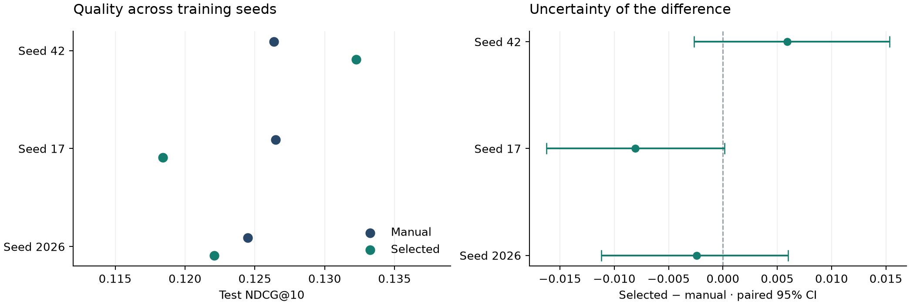
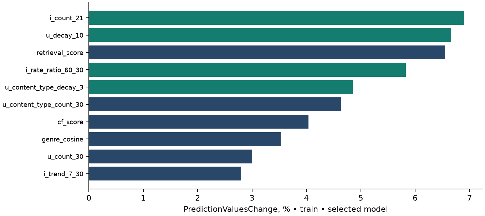
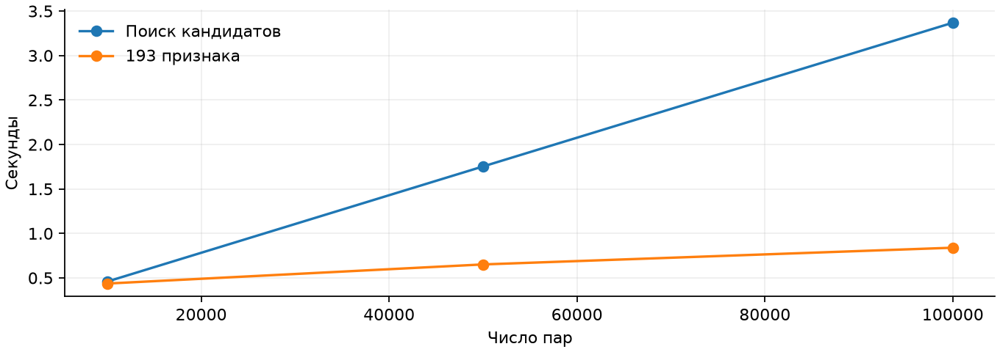

# Temporal feature search on KION

Исследование временных признаков для рекомендаций фильмов: можно ли улучшить ручной набор признаков, автоматически перебирая окна агрегации и затухание интересов?

Эксперимент проведён на истории 10 000 пользователей KION. Из 64 базовых признаков получено 193 кандидата; после отбора осталось 76. Ранжирование — CatBoost, генерация кандидатов и временные срезы общие для всех вариантов.

**Устойчивого выигрыша не получилось.** Средний test NDCG@10 по трём seed — 0.12578 для ручных признаков и 0.12425 после отбора. На seed 42 отбор дал +4.7%, но знак эффекта меняется между запусками, а все парные 95% доверительные интервалы включают ноль.



[Полный отчёт · PDF](reports/TLab_Report.pdf) · [Методика и разбор экспериментов](reports/EXPERIMENT.md) · [Результаты · CSV](results/main/test_metrics.csv)

## Результаты

Сравнение на финальной неделе, seed 42. NDCG и Recall усредняются по 653 пользователям с положительными событиями; всего в тесте 2 377 запросов. Значения для всех запросов также сохранены в CSV.

| Признаки | Число | NDCG@10 | Recall@10 | ROC AUC |
|---|---:|---:|---:|---:|
| Популярность | 2 | 0.12498 | 0.19350 | 0.67988 |
| Ручные | 64 | 0.12636 | 0.19633 | 0.81928 |
| Все сгенерированные | 193 | 0.11843 | 0.19663 | 0.81820 |
| После отбора | 76 | 0.13226 | 0.20282 | 0.82234 |
| Без косвенных признаков | 28 | 0.11027 | 0.19529 | 0.79192 |

Добавление всех признаков ухудшило ранжирование. Отбор помог относительно полного набора, но его преимущество над ручным набором оказалось нестабильным. AUC считается по всем парам и не заменяет метрики ранжирования внутри пользователя.

Глубина и число деревьев выбирались отдельно для каждого варианта. Это сравнение полных процедур обучения, а не изолированная оценка причинного эффекта дополнительных признаков. Интервалы получены парным bootstrap по пользователям, 2 000 повторений для каждого seed.

## Как устроен эксперимент

```text
История до cutoff
  ├── популярность за 7 дней и за всю историю
  ├── item-item similarity и близость по жанрам
  │      └── объединение RRF → 100 кандидатов на пользователя
  └── признаки пользователя, фильма и пары
         └── ручные / все / отобранные → CatBoost → top 10

Следующая неделя → только метки и оценка
```

Автоматическая генерация перебирает окна 1, 3, 10, 14, 21 и 60 дней, а также экспоненциальное затухание с масштабами 3, 10 и 30 дней. Признаки описывают активность, популярность, изменение частоты взаимодействий и предпочтения по типам контента. Дополнительные признаки ранжируются по важности на обучении; размеры набора 12, 24 и 48 проверяются на отдельной неделе поиска.



Важности рассчитаны на обучающем наборе через `PredictionValuesChange`. Они характеризуют конкретную модель и не доказывают причинного влияния признака.

## Разбиение и защита от утечек

| Этап | Начало целевой недели |
|---|---|
| Обучение, три среза | 12, 19 и 26 июля 2021 |
| Выбор набора признаков | 2 августа 2021 |
| Настройка модели | 9 августа 2021 |
| Финальный тест | 16 августа 2021 |

История для любого признака строго предшествует cutoff. Когорта выбирается из пользователей, известных до первого среза; будущая активность не служит условием включения. Лимит 2 000 обучающих запросов на срез не обрезает историю для расчёта признаков.

Во всех вариантах используются одни и те же кандидаты. Будущие положительные объекты в выдачу не подмешиваются, уже просмотренные исключаются. Знаменатель Recall и идеальный DCG учитывают полный набор целевых объектов, включая не найденные retrieval.

Macro Recall@100 генератора кандидатов — **0.38566**. Даже идеальный порядок внутри этих кандидатов даёт NDCG@10 лишь **0.43154**: качество retrieval заметно ограничивает итоговую систему.

Параметры зафиксированы до финальной оценки в [locked_config.json](results/main/locked_config.json). Подробности — в [протоколе](PROTOCOL.md), [аудите](results/main/audit_final.json) и [заметках о проверках](QA_NOTES.md).

## Воспроизведение

```bash
git clone https://github.com/KarinaSH7/kion-temporal-features.git
cd kion-temporal-features
python3.11 -m venv .venv
source .venv/bin/activate
python -m pip install -r requirements-lock.txt
python -m pytest -q
```

Репозиторий содержит результаты исходного запуска, модели и предсказания. Чтобы сохранить их перед повторным экспериментом:

```bash
mv results/main results/main_reference
PYTHON=.venv/bin/python bash run.sh
```

Скрипт скачает данные, подготовит временные срезы, выполнит поиск, обучение, аудит и построит отчёт. Исходный архив и промежуточные таблицы не хранятся в Git. Для загрузки нужен доступ к интернету.

Можно выполнять этапы отдельно:

```bash
python -m src.data --users 10000
python -m src.experiment build-dev
python -m src.audit
python -m src.experiment select
python -m src.experiment final-test
python -m src.audit --include-test
python -m src.benchmark
python -m src.report
python -m src.plot_results
```

10 тестов проверяют временные границы, исключение просмотренного, воспроизводимость и расчёт метрик. Отдельный аудит проверяет срезы и независимо пересчитывает итоговые NDCG и Recall.

## Время и масштабирование

На исходной машине генерация тестовых кандидатов заняла 9.15 с, признаки — 1.52 с. Поиск признаков и конфигурации — около 160.7 с. Это измерения локального запуска с четырьмя вычислительными потоками, а не производственный latency benchmark.



## Что ограничивает выводы

- `last_watch_dt` в KION — последняя дата агрегированной пары пользователь–фильм, а не полный журнал просмотров. Временная динамика восстановлена лишь приближённо. `total_dur` и `watched_pct` исключены из признаков.
- Проверены одна когорта и одна финальная неделя. Bootstrap по пользователям не измеряет неопределённость между будущими временными периодами.
- Retrieval работает с каталогом, известным по истории выборки. Холодные объекты остаются ограничением.
- В текущей реализации рассчитывается полный набор признаков даже для отобранной модели. Отбор не означает пропорционального ускорения.
- Матрица совместных просмотров может стать плотной при увеличении данных; локальные замеры нельзя линейно переносить на весь датасет.

Следующая проверка — несколько последовательных временных тестов и сравнение наборов при одинаковых параметрах модели. Подбирать новые параметры на уже использованной финальной неделе нельзя.

## Навигация

| Файл | Назначение |
|---|---|
| [`src/data.py`](src/data.py) | Загрузка, проверка источника, выбор когорты |
| [`src/features.py`](src/features.py) | Retrieval и признаки |
| [`src/experiment.py`](src/experiment.py) | Поиск, обучение, финальная оценка |
| [`src/metrics.py`](src/metrics.py) | Метрики и bootstrap |
| [`src/audit.py`](src/audit.py) | Независимые проверки |
| [`results/main`](results/main) | Конфигурация, таблицы, модели и предсказания |
| [`reports/EXPERIMENT.md`](reports/EXPERIMENT.md) | Полный разбор задания и результатов |

Источник данных — [KION от МТС](https://github.com/irsafilo/KION_DATASET), commit `f69775be31fa5779907cf0a92ddedb70037fb5ae`. Используется полный `data_en.zip`: отдельный архив `interactions.csv.zip` оказался обрезанным. Причина и проверка описаны в отчёте.

Автор: Карина Шаля. Проект подготовлен для отбора в T Lab, AI Research. Codex использован при реализации, тестировании и подготовке отчёта; метрики получены в локальных запусках и сохранены вместе с результатами.
