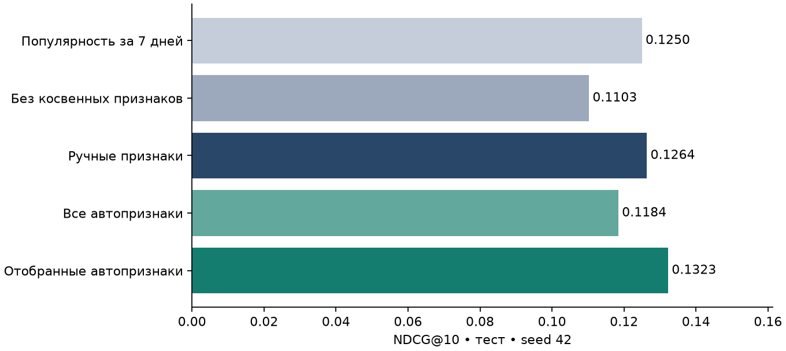

# T Lab · Автоматический поиск временных признаков для рекомендаций

**Воспроизводимый эксперимент на KION · Python / CatBoost · 10 000 пользователей**

## Краткий результат

На основном seed статистически убедительное превосходство автоматического отбора не установлено: парный 95%-й интервал не лежит целиком выше нуля. NDCG@10: **0.12636 → 0.13226**, изменение
**+0.00590** (+4.67% относительно baseline), парный 95% CI
**[-0.00267; +0.01532]**.

Среднее NDCG@10 по трём seed: manual 0.12578 (SD 0.00111), selected 0.12425 (SD 0.00718). Это разброс обучения на одной когорте, не три независимых датасета.
**Устойчивость:** Знак эффекта меняется между seed: улучшение неустойчиво к случайности обучения.

В ручном baseline 64 признака. Грамматика строит 193 признака; отбор сохранил
76 (64 ручных + 12 дополнительных). Все числа ниже получены реальными
запусками; результаты поиска, модели, конфигурации и логи сохранены. Это локальная
исследовательская работа, а не результат официального leaderboard KION.



## 1. Постановка задачи и данные

Для пользователя u в момент t требуется ранжировать ранее не наблюдавшиеся фильмы.
Положительный объект — зарегистрированное взаимодействие в интервале [t, t+7 дней).
Отсутствие записи в этом интервале даёт метку 0. Это implicit-feedback задача:
неизвестно, был ли объект показан. Нулевую метку нельзя интерпретировать как
доказанный отказ, а выход модели — как CTR.

Использован официальный [KION](https://github.com/irsafilo/KION_DATASET), commit
`f69775be31fa5779907cf0a92ddedb70037fb5ae`. Полный архив `data_en.zip` содержит
5,476,251 строк, 962,179 пользователей и
15,706 объектов. Реальные даты файла: 2021-03-13—2021-08-22;
они проверены в данных, а не взяты из описания репозитория. Русские метаданные
объектов загружены из `data_original/items.csv` той же версии.

**Важная проверка источника.** Отдельный `interactions.csv.zip` в этом commit содержит
лишь 1 594 787 строк, последняя дата — `20`; распакованный размер ровно 50 MiB.
Архив проходит CRC, но содержимое обрезано. Он НЕ использован в эксперименте.
Загрузчик проверяет SHA-256, CRC, ожидаемые 5 476 251 строк, формат дат, отсутствие
пропусков и уникальность пары user–item. Это существенно для сохранения истории.

Выборка: случайные 10 000 пользователей (seed=42) среди известных до первого
обучающего среза. Для каждого сохранены ВСЕ строки исходного набора, включая
будущие строки, которые далее изолируются временными фильтрами. Получено
64,636 взаимодействий с 5,463 объектами. Проверено
равенство числа строк по каждому пользователю в исходнике и выборке. Когорта
заранее фиксирована и смещена в сторону пользователей, уже известных к 12 июля;
выводы не распространяются автоматически на новых пользователей.

KION хранит **одну агрегированную строку на пару** с `last_watch_dt`, а не полный
журнал всех сеансов. Здесь эта строка трактуется как псевдособытие в указанную дату.
`total_dur` и `watched_pct` не используются: они агрегированы и не имеют надёжной
исторической доступности. Сохраняется вся опубликованная история, но восстановить
все реальные повторные просмотры из неё нельзя. Будущая повторная активность могла
перенести `last_watch_dt` и скрыть более ранний просмотр. Поэтому гарантируется
point-in-time корректность относительно **опубликованных псевдособытий**, а не
полное восстановление реальной онлайн-истории. Это ограничение выбранного датасета.

Используются статические характеристики объекта (жанр, страна, режиссёр, тип,
год выпуска, возрастной рейтинг, for_kids). Предполагается, что они доступны при
появлении объекта; исторических версий метаданных нет. Динамические демографические
характеристики пользователей и текстовые описания не используются.

## 2. Временное разбиение и защита от утечек

| Срез | Начало | Конец, не включён | Запросы | Пары | Положит. запросы | Положит. пары |
| --- | --- | --- | --- | --- | --- | --- |
| train_1 | 2021-07-12 | 2021-07-19 | 2000 | 200000 | 403 | 444 |
| train_2 | 2021-07-19 | 2021-07-26 | 2000 | 200000 | 408 | 370 |
| train_3 | 2021-07-26 | 2021-08-02 | 2000 | 200000 | 412 | 368 |
| search | 2021-08-02 | 2021-08-09 | 3276 | 327600 | 723 | 683 |
| tune | 2021-08-09 | 2021-08-16 | 2572 | 257200 | 657 | 507 |
| test | 2021-08-16 | 2021-08-23 | 2377 | 237700 | 653 | 580 |

История каждого среза: строго `timestamp < cutoff`. Окно длины w: `[t-w,t)`.
Цели: `[t,t+7d)`. Границы полуоткрытые; одинаковые timestamps целиком остаются
по одну сторону границы. Все обучающие метки известны до начала validation-search.
Модель после подбора не переобучается на валидации: сравнение использует один train.
При тестовом прогнозе история обновляется событиями до 16 августа, в том числе
прошлыми валидационными событиями. Это допустимая информация в момент прогноза.

Пользователи запроса определяются только по прошлому: минимум одно псевдособытие
за 28 дней. На каждом из трёх train-срезов берутся до 2 000 таких пользователей
случайно, с фиксированным seed; validation/test используют всех подходящих.
Это ограничение числа обучающих запросов, а не усечение их истории. Пользователи
без будущих positives остаются в обучении и в таблице кандидатов.

Запрещены и проверяются: будущие события в агрегатах и графе, будущее появление
объектов в каталоге, добавление правильного ответа в кандидаты, random split строк,
настройка по тесту. `src/features.py` разделяет retrieval/features и attach_labels;
будущие labels не передаются в функции построения кандидатов или признаков.

10 модульных тестов проверяют строгую границу времени, левую границу окна,
инвариантность features/retrieval при добавлении будущих событий, отсутствие
просмотренных/будущих объектов в retrieval, сохранение полной истории, формулы
NDCG/Recall с пропущенным positive, tie-breaking, bootstrap и конец горизонта.
Дополнительно `src.audit` сверяет 100 случайных строк каждого среза с исходными
событиями прямым пересчётом 12 условий на строку; для основного сравнения
независимо пересчитывает итоговые NDCG и Recall из сохранённых предсказаний.

## 3. Фиксированный поиск кандидатов

Каталог каждого среза — объекты, встречавшиеся до cutoff в истории выбранной
когорты. Просмотренные пары исключаются. Четыре канала предлагают до 100 объектов:

1. Популярность за 7 дней.
2. Популярность за всю доступную историю.
3. Item-item cosine по бинарной user–item матрице. Similarity умножается на
   `co_count / (co_count + 10)`; у каждого объекта оставляются 50 соседей.
4. Сходство пользовательской истории со всеми жанрами кандидата, умноженное
   на `log(1 + item_popularity)`.

Каналы объединяются reciprocal-rank fusion: `sum(1/(60+rank))`.
В финале остаются 100 объектов, ties разрешаются по item_id. Никаких случайных
отрицательных объектов или вставки будущих положительных объектов нет.
Все методы используют **одни и те же сохранённые строки**, их hash записан для
каждого среза. Это сравнение reranker при фиксированном retrieval, не сравнение
разных end-to-end retrieval-алгоритмов.

На тесте 2377 запросов, из них 653 с будущими положительными объектами. Recall retrieval@100 = 0.3857 (macro по таким пользователям); доля целевых объектов в известном каталоге = 0.9491 (micro). Эти величины имеют разные знаменатели и не должны напрямую сравниваться как одна метрика.

Диагностический потолок NDCG@10 при идеальном порядке уже извлечённых кандидатов:
**0.43154**. Для него labels используются только после завершения
retrieval, как теоретическая граница, не как обучаемый метод или подбор модели.

## 4. Сильный ручной baseline

CatBoostClassifier с LogLoss обучается на всех 600 000 train-парах. Отрицательные
строки дополнительно не сэмплируются, class weights не используются. 64 признака:

- пользователь: числа взаимодействий за 7/30 дней и всё время, уникальные объекты,
  активные дни, разнообразие жанров, давность последнего события;
- объект: частоты и доли за те же окна, давность, статические категории и год;
- пара user–item: исторические счётчики и давность;
- косвенные связи user–genre/country/director/content_type: частоты, доли, давность;
- отношения 7/30 дней; item-item score, сходство по жанрам, fusion score и rank.

Агрегаты по категории используют первое значение списка, чтобы явно ограничить
стоимость; жанровый retrieval использует все жанры. Это упрощение документировано.
Прямые user–item признаки здесь нулевые/константные, поскольку рекомендуются новые
пары, а исходник уникален по паре. CatBoost игнорирует такие признаки; результат
не выдаётся за исследование повторного потребления. IDs не передаются как категории,
поэтому нет запоминания конкретного пользователя по идентификатору.

## 5. Исследовательская идея: ограниченная грамматика признаков

Гипотеза: стандартные 7/30 дней не оптимальны для всех связей. Алгоритм может
автоматически строить дополнительные масштабы времени и выбирать компактное
дополнение к сильному baseline. Это bounded feature synthesis, а не LLM-агент
и не утверждение о принципиально новом алгоритме автоматического ML.

Для ключа k определён счётчик
`A(k,w,t) = sum(1[key(event)=k] * 1[t-w <= timestamp < t])`.
Грамматика комбинирует семь ключей: u, i, (u,i), (u,genre), (u,country),
(u,director), (u,content_type), окна 1/3/10/14/21/60 дней и операторы:
count, сглаженная доля, отношение к 30-дневному масштабу, экспоненциальное затухание.
Half-life затухания: 3/10/30 дней,
`E(k,h,t) = sum(1[key=k] * 2^(-(t-timestamp)/h))`.
Доля категории: `A(u,c,w)/(A(u,w)+1)`; сглаженное отношение счётчиков:
`(A(k,w)+1)/(A(k,30)+30/w)`. Все промежуточные величины — только из прошлого.

После раскрытия грамматики получается 129 дополнительных столбцов, всего 193.
Пилотный CatBoost (depth=5, 200 деревьев) ранжирует дополнительные признаки по
PredictionValuesChange на **train**. Константные/нулевые по важности не включаются
в список. Проверяются префиксы top-12/top-24/top-48, каждый вместе со всеми ручными
признаками. Размер выбирается по NDCG@10 на validation-search. Выбран top-12.

Ограничение: поиск не перебирает произвольные SQL-программы, а важность отдельного
признака может пропустить полезные взаимодействия. Схема связей и пространство
операторов заданы человеком. Автоматизированы генерация комбинаций и отбор,
а не вся постановка задачи.

## 6. Честное сравнение

Четыре обучаемые ветки: manual; manual+all-auto; manual+selected-auto;
manual без косвенных агрегатов и retrieval scores. Последняя — абляция reranker:
персонализированный retrieval остаётся общим, поэтому это не полностью
неперсонализированная система. Дополнительно показан popularity baseline.

У всех обучаемых веток одна сетка: depth 5/7, learning_rate=0.07, l2=5,
300 деревьев, checkpoints 100/200/300. Два fit на ветку, шесть проверок качества.
Лучший checkpoint определяется по NDCG@10 только на validation-tune. Категории
обрабатывает CatBoost, 4 CPU threads, основной seed=42. У selected есть
**дополнительный бюджет поиска** (пилот + 3 fit), он явно учитывается.

| Метод | F | Глубина | Деревья | Tune NDCG@10 |
| --- | --- | --- | --- | --- |
| Ручные признаки | 64 | 5 | 200 | 0.11069 |
| Все автопризнаки | 193 | 5 | 300 | 0.11016 |
| Отобранные автопризнаки | 76 | 7 | 300 | 0.10952 |
| Без косвенных признаков | 28 | 7 | 100 | 0.09268 |

Конфигурация сохранена в `locked_config.json` с временем и hash протокола
**до** построения тестовых признаков. `select` не читает test-файлы, а `final-test`
требует lock и отказывается перезаписывать существующую итоговую таблицу.
Контроль не является криптографическим proof предрегистрации; это локальный
журнал эксперимента и программная защита от случайного повторного подбора.

## 7. Метрики

NDCG@10 и Recall@10 усредняются по пользователям с хотя бы одним новым
положительным объектом в горизонте. Нормировка IDCG использует **все** positives,
включая не попавшие в retrieval и отсутствующие в известном каталоге:
`IDCG@10 = sum(j=1..min(10,|R_u|), 1/log2(j+1))`.
Это качество полученных top-10 относительно всей наблюдаемой релевантности,
а не NDCG на искусственном наборе «один positive + sampled negatives».
Фильтр положительных запросов применяется только при вычислении метрики,
не при построении запросов, истории или кандидатов.

NDCG@10 по всем запросам, включая пользователей без будущего просмотра: manual 0.03471, selected 0.03633.

ROC-AUC и LogLoss считаются на полной общей таблице кандидатов, в том числе
для пользователей без будущих взаимодействий. Они относятся только к этой
политике retrieval и бинарной метке потребления; не измеряют калибровку CTR.
Для popularity LogLoss не приводится: raw popularity не вероятность.
Сравнение primary: selected − manual. Парный bootstrap пользователей, 2 000
повторов с seed 42; 95% percentile interval. На одном test-срезе у пользователя
один запрос, поэтому единица ресэмплирования соответствует зависимости данных.

## 8. Результаты

| Метод | F | NDCG@10 | Recall@10 | ROC-AUC | LogLoss |
| --- | --- | --- | --- | --- | --- |
| Популярность за 7 дней | 2 | 0.12498 | 0.19350 | 0.67988 | - |
| Без косвенных признаков | 28 | 0.11027 | 0.19529 | 0.79192 | 0.01566 |
| Ручные признаки | 64 | 0.12636 | 0.19633 | 0.81928 | 0.01514 |
| Все автопризнаки | 193 | 0.11843 | 0.19663 | 0.81820 | 0.01524 |
| Отобранные автопризнаки | 76 | 0.13226 | 0.20282 | 0.82234 | 0.01520 |

**Основное сравнение:** На основном seed статистически убедительное превосходство автоматического отбора не установлено: парный 95%-й интервал не лежит целиком выше нуля. Разность +0.00590, относительное изменение
+4.67%. Все ветки показаны, но победитель не выбирается задним числом по тесту.

| Seed | Manual | Selected | Разность | 95% CI разности |
| --- | --- | --- | --- | --- |
| 42 | 0.12636 | 0.13226 | +0.00590 | [-0.00267; +0.01532] |
| 17 | 0.12649 | 0.11841 | -0.00807 | [-0.01624; +0.00013] |
| 2026 | 0.12450 | 0.12208 | -0.00242 | [-0.01120; +0.00599] |

Среднее NDCG@10 по трём seed: manual 0.12578 (SD 0.00111), selected 0.12425 (SD 0.00718). Это разброс обучения на одной когорте, не три независимых датасета. Дополнительные seed не используются для выбора признаков или
параметров. Интервалы условны относительно фиксированной когорты, недели и retrieval;
они не учитывают весь разброс по датасетам, времени и процедуре model selection.
Знак эффекта меняется между seed: улучшение неустойчиво к случайности обучения.

## 9. Что сработало и что ограничивает результат

Простой popularity baseline даёт NDCG@10 **0.12498**, близко к
ручному CatBoost **0.12636**. Более сложная модель здесь не доказала
существенного превосходства над популярностью. Под «сильным baseline» понимается
содержательная инженерная конструкция и честный подбор, а не доказанный SOTA.
Глобальная AUC CatBoost выше, но её могут улучшать пользовательские признаки
вероятности активности, одинаковые для всех кандидатов пользователя. Это
не обязательно улучшает порядок объектов внутри его списка; поэтому primary — NDCG.

- Полный набор: NDCG@10 0.11843, разность с ручным baseline
  -0.00793. Больше признаков не означает лучшее обобщение.
- Отбор: NDCG@10 0.13226; разность с all-auto
  +0.01383. Это описательное сравнение, без отдельного
  подтверждающего теста гипотезы; основная заранее выбранная пара — selected/manual.
- Абляция косвенных сигналов: NDCG@10 0.11027 против 0.12636
  у полного ручного baseline. Проверяется совместный блок сигналов, не отдельный
  жанр или окно, и персонализированный retrieval остаётся неизменным.
- LogLoss selected 0.015196, manual 0.015144; ROC-AUC
  0.82234 и 0.81928. Разные метрики могут двигаться в разные стороны:
  checkpoint выбирался по NDCG, а не по калибровке вероятностей. Утверждение
  о безусловном улучшении всех аспектов качества не делается.

Параметры каждой ветки выбирались отдельно из одинаковой сетки. Поэтому наблюдаемая
разность относится к **всей процедуре feature search + model selection**, а не
к чистому причинному эффекту добавленных столбцов при одинаковой глубине/числе деревьев.
Знак эффекта меняется между seed: улучшение неустойчиво к случайности обучения. Более высокая вариативность может быть связана с разреженными
положительными метками, коррелированными признаками и выбранной глубиной дерева;
это объясняющие гипотезы, а не доказанные причины. Их следует проверять matched-depth
сравнением и несколькими временными фолдами, а не новым подбором на этом test.

Наиболее важные признаки итоговой selected-модели: i_count_21 (6.90%); u_decay_10 (6.66%); retrieval_score (6.55%); i_rate_ratio_60_30 (5.83%); u_content_type_decay_3 (4.85%); u_content_type_count_30 (4.64%); cf_score (4.04%); genre_cosine (3.53%).

Ведущие автоматически добавленные признаки: i_count_21 (6.90%); u_decay_10 (6.66%); i_rate_ratio_60_30 (5.83%); u_content_type_decay_3 (4.85%); i_rate_ratio_1_30 (1.60%); u_country_share_21 (1.34%); i_count_3 (1.27%); i_decay_3 (1.22%); i_share_1 (0.80%); u_country_count_60 (0.66%).
Полный список отбора: `results/main/locked_config.json`, таблицы важности:
`*_importance.csv`. Importance не является причинным эффектом; коррелированные
окна делят важность. Ветка all-auto отделяет эффект увеличения пространства
от эффекта его отбора; no-indirect показывает совместную роль косвенных связей
и переданных retrieval scores. Индивидуальный вклад каждого окна экспериментально
не изолирован, поэтому причинные утверждения о конкретном окне не делаются.

Короткие и длинные окна дают модели разные масштабы активности и популярности.
Но полный набор увеличивает вычисления и риск подгонки, а отбор на одной неделе
может быть нестабилен при temporal drift. На основном seed статистически убедительное превосходство автоматического отбора не установлено: парный 95%-й интервал не лежит целиком выше нуля.

Разрезы по длине истории 1–2, 3–5, 6–20 и 21+ доступны в
`activity_strata.csv`; это описательный анализ, не новые основания для настройки.
Пропуски retrieval ограничивают максимально достижимое качество любого reranker.
Следующий содержательный эксперимент — несколько rolling-origin test-недель
с полностью вложенным подбором, более крупные пользовательские когорты,
out-of-time permutation importance и cost-aware отбор групп признаков.

## 10. Вычислительные затраты и масштабируемость

| Метод | 2 обучающих запуска, с | Inference всего теста, с | Модель, MiB |
| --- | --- | --- | --- |
| Ручные признаки | 114.7 | 0.031 | 0.68 |
| Все автопризнаки | 147.4 | 0.055 | 0.38 |
| Отобранные автопризнаки | 120.9 | 0.043 | 1.18 |
| Без косвенных признаков | 102.7 | 0.024 | 2.16 |

Построение кандидатов на тесте: 9.15 с; всех признаков:
1.52 с; вся подготовка тестового среза:
11.44 с. Время отдельного поиска selected:
**160.7 с**, сверх общей сетки финальных моделей.
Время inference не включает чтение файлов и сборку CatBoost Pool; эти составляющие
разделены в `runtime.csv`. Размер DataFrame всех тестовых признаков:
190.7 MiB; это не полная память процесса.
Фактическая платформа и peak RSS сохранены в environment/audit JSON.
Замеры wall-clock сделаны на рабочем ноутбуке, без изоляции фоновой нагрузки;
они ориентировочные, разброс времени повторными прогонами не оценивался.


`scaling.csv` содержит label-free измерения 100/500/1000 запросов на одном
историческом срезе; каталог и история фиксированы, каждый размер измерен один раз.
Это микробенчмарк числа запросов, не доказательство работы на миллиардах событий.

Генерация F агрегатов в текущей реализации повторяет groupby для каждого окна:
примерно O(W·R·H + F·Q·C), где H — история, Q — запросы, C=100, R — ключи.
Хранение признаков O(F·Q·C). При промышленном масштабе нужны инкрементальные
счётчики, оконные состояния, feature store и вычисление только выбранных столбцов.
Текущий builder всегда строит все 193 столбца; меньший selected-набор экономит
обучение/скоринг модели, **но не доказанно экономит feature generation**.

Item-item cooccurrence строится sparse-multiplication, но может уплотняться;
на больших каталогах его стоимость определяется суммой квадратов длин историй.
Прореживание top-50 выполняется после умножения и не снимает этот пиковый риск.
Поиск кандидатов в Python сортирует известный каталог по каждому пользователю,
порядка O(Q·I·log I). Для production нужны блочные top-k, ANN, distributed retrieval
и контроль активности heavy users; простое увеличение объёма здесь недостаточно.

## 11. Ограничения и честные выводы

1. Единственная случайная когорта из 10 000 пользователей и один test-горизонт.
2. KION — агрегированная implicit-feedback выгрузка; повторные сеансы потеряны,
   достоверные показы/негативы отсутствуют, возможен exposure bias. Любое
   зарегистрированное взаимодействие считается positive; удовлетворённость
   пользователя и минимальная длительность просмотра не оцениваются.
3. Условие активности за 28 дней исключает холодных и давно неактивных пользователей.
4. Известный каталог строится только по сэмплу: часть реально доступных объектов
   не попадает в него, но их будущая релевантность остаётся в знаменателе метрики.
5. Снимок item metadata считается статическим; нельзя доказать историческую
   доступность каждого поля. Демография и агрегированная длительность исключены.
6. Конечная грамматика и ограниченный поиск не доказывают оптимальность признаков.
7. Результаты нельзя напрямую сопоставлять с официальным leaderboard, другим
   retrieval, CTR-задачей или онлайн-эффектом. A/B-тест не проводился.

Практический вывод: автоматизацию нужно оценивать как добавку к сильному
воспроизводимому baseline с честным бюджетом поиска, а не заменять проверку
гипотез большим числом признаков. На основном seed статистически убедительное превосходство автоматического отбора не установлено: парный 95%-й интервал не лежит целиком выше нуля.

## 12. Воспроизведение

Python **3.11**, CPU, интернет только для публичных данных и PyPI. GPU и платные API
не нужны. Рекомендуется 8–16 GiB RAM; точное время зависит от CPU. Зафиксированные
версии в `requirements-lock.txt`, ключевые прямые зависимости в `requirements.txt`.

```bash
python3.11 -m venv .venv
source .venv/bin/activate
python -m pip install -r requirements-lock.txt
python -m pytest -q
python -m src.data --users 10000
python -u -m src.experiment build-dev
python -u -m src.audit
python -u -m src.experiment select
python -u -m src.experiment final-test
python -u -m src.audit --include-test
python -u -m src.benchmark
python -m src.report
```

Альтернатива после установки зависимостей: `PYTHON=.venv/bin/python bash run.sh`.
В поставке есть уже рассчитанные результаты. Для **полного нового прогона** сначала
сохраните их под другим именем: `mv results/main results/main_reference`.
Новый запуск создаст `results/main`; исходные данные при повторном запуске не
скачиваются заново, а проверяются checksum. Небольшие расхождения времени и
floating-point результатов между платформами возможны; фиксированный seed не
обещает побитовую идентичность разных CPU/версий. Архив содержит модели, метрики,
логи и per-user результаты; сырые данные и тяжёлые feature caches скачиваются/
создаются командами выше.

Для иной когорты: `python -m src.data --users 5000`, затем те же три стадии
`src.experiment` с `--users 5000`. Это новый эксперимент; его результаты здесь
не заявляются. `src.report` и query-scaling benchmark оформляют основной 10k run.

### Структура

- `PROTOCOL.md`: протокол до открытия теста.
- `src/data.py`: загрузка, проверки, полные истории пользователей.
- `src/features.py`: retrieval и point-in-time признаки, отдельное добавление labels.
- `src/experiment.py`: подбор, фиксация, финальная оценка.
- `src/metrics.py`: метрики и парный bootstrap.
- `tests/test_temporal.py`: проверки корректности на контролируемых данных.
- `results/main/`: trials, configuration lock, метрики, статистика срезов, модели.
- `reports/TLab_Report.pdf`: краткая версия этого отчёта; графики рядом.

### Соответствие четырём требованиям задания

| Требование | Реализация | Доказательство |
| --- | --- | --- |
| Сильный baseline | CatBoost, 64 ручных признака, временные срезы | Код, тесты, manual-строка метрик |
| Исследовательская идея | Грамматика 129 новых агрегатов + автоматический top-k отбор | pilot_importance, search_trials, lock |
| Сравнение | Общие кандидаты, две validation-недели, закрытый test, 3 seeds | Hash кандидатов, tuning_trials, test_metrics, bootstrap |
| Анализ | All-auto/no-indirect абляции, importance, разрезы, стоимость и ограничения | Таблицы, графики, scaling.csv, разделы 9–11 |

## 13. Источники и использование инструментов

1. Petrov et al. **MTS Kion Implicit Contextualised Sequential Dataset for Movie
   Recommendation** (2022). [Статья](https://arxiv.org/abs/2209.00325),
   [официальные данные](https://github.com/irsafilo/KION_DATASET).
2. Prokhorenkova et al. **CatBoost: unbiased boosting with categorical features**
   (NeurIPS 2018). [Статья](https://proceedings.neurips.cc/paper/2018/hash/14491b756b3a51daac41c24863285549-Abstract.html).
   [API](https://catboost.ai/docs/en/concepts/python-reference_catboostclassifier).
3. Kanter, Veeramachaneni. **Deep Feature Synthesis: Towards Automating Data Science
   Endeavors** (2015). [Статья MIT](https://dai.lids.mit.edu/wp-content/uploads/2017/10/DSAA_DSM_2015.pdf).
   Связь с работой: ограниченная композиция агрегатов по реляционным ключам;
   здесь дополнительно явно задаются временные границы и валидационный отбор.
4. Krichene, Rendle. **On Sampled Metrics for Item Recommendation** (KDD 2020).
   [Страница авторов](https://research.google/pubs/on-sampled-metrics-for-item-recommendation/).
   В этой работе не используется оценка на случайно выбранных negatives: оценивается
   фиксированная retrieval-политика с полным знаменателем наблюдаемых positives.

Codex использован для реализации, тестирования и подготовки отчёта, что разрешено
условием задания. Эксперименты выполнены локально, результаты не вымышлены.
Перед защитой необходимо понимать определения target, временные границы,
ограничения KION и смысл доверительного интервала. Публикация на GitHub и
отправка в T Lab автоматически не выполнялись. Данные остаются у исходного
правообладателя, в архив решения не включены; условия их использования следует
проверять у источника при дальнейшей публикации.
